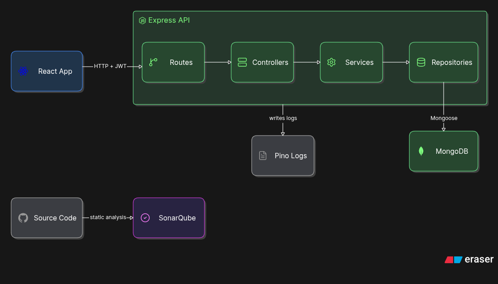
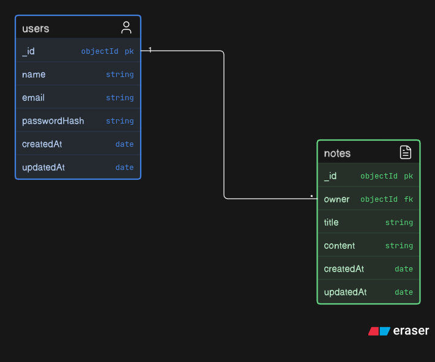
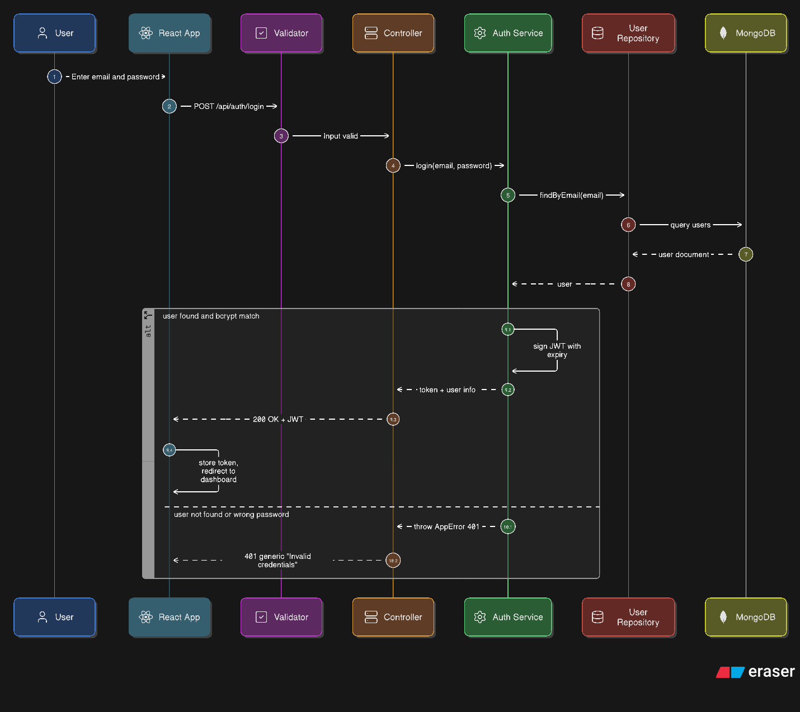
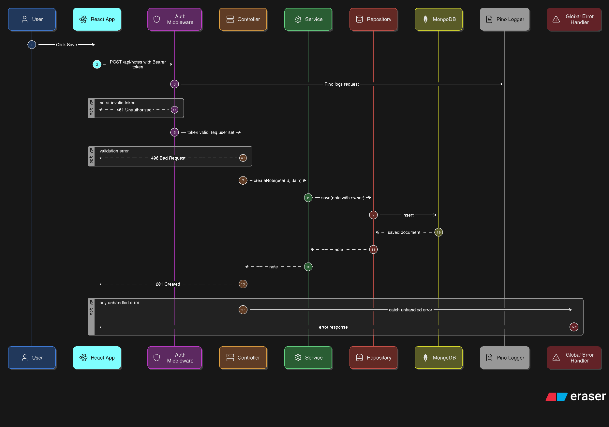

# Notes App

A full-stack Notes application (React, Node.js, MongoDB) where users can
sign up, log in, and create, edit, and delete their own notes.

## Status
Design phase. Documentation added; implementation in progress.

## Tech Stack
- Frontend: React.js
- Backend: Node.js, Express
- Database: MongoDB (Mongoose)
- Logging: Pino
- Testing: Mocha/Chai (backend), Jest (frontend)
- Code quality: SonarQube

## Architecture
Backend layers: Routes → Controllers → Services → Repositories → MongoDB

### System Architecture

### Entity Relationship Diagram

### Login Flow

### Create Note Flow

